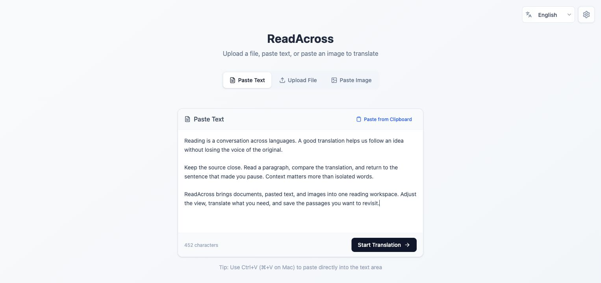
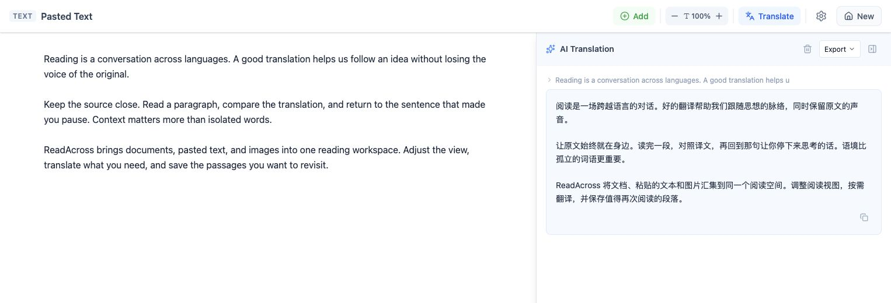
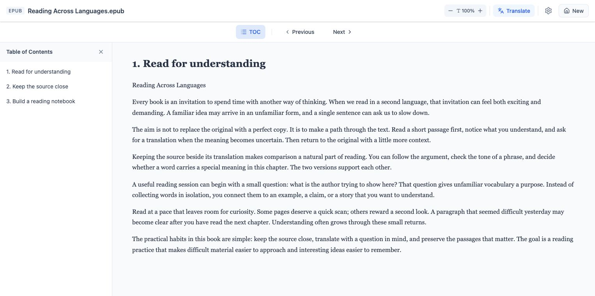

# ReadAcross


**English** | [简体中文](README.zh-CN.md)

Read and translate documents, text, images, and webpages with AI.

## Features

- **PDF & EPUB** — Chapter/page navigation, PDF links, zoom, and font-size controls.
- **Text & images** — Paste text or upload images with browser-based OCR.
- **Bilingual reading** — Translate a selection or current page, compare both versions, and jump back to the source.
- **Save & export** — Resume local document reading positions and completed translations; export Markdown.
- **Seven Web interface languages** — 简体中文, English, 日本語, Français, Deutsch, Português, and 繁體中文.
- **Browser extension** — Inline webpage translation, GitHub content, and YouTube captions when available.

## Screenshots

**Text, file, and image input**



**Source and translation side by side**



**EPUB reading with a table of contents**



Screenshots use sample content. The bilingual view uses a local demonstration translation.

## Run locally

Requires Node.js 20.19+ within 20.x, or 22.12+, and [pnpm](https://pnpm.io/installation).

```bash
git clone https://github.com/ang2ang/readacross.git
cd readacross
pnpm install
pnpm --filter @readacross/web dev
```

Open the URL printed by Vite (usually `http://localhost:5173`). Configure a provider in **Settings**: OpenAI, DeepSeek, Ollama Cloud, Local LLM, or the hosted proxy.

Hosted mode needs a configured model backend. During Vite development, `/api/openai` forwards to Ollama at `http://localhost:11434/v1` by default. For a remote upstream, set `OLLAMA_PRIVATE_BASE_URL` in `apps/web/.dev.vars` and restart Vite.

To develop the extension:

```bash
pnpm --filter @readacross/extension dev
```

In `chrome://extensions`, enable **Developer mode**, choose **Load unpacked**, and select `apps/extension/build/chrome-mv3-dev`. Refresh webpage tabs after rebuilding or reloading the extension.

## Usage

1. Choose an interface language on the home screen; configure the model and translation target in **Settings**.
2. Paste text, upload images, or open a PDF/EPUB. In a document, click **Translate** to translate a selection or the current page/view.
3. Use **Locate source** to check the original and **Return to reading** to resume. **Export** copies or downloads completed translations as Markdown.
4. Configure the extension separately in its popup. Toggle webpage translation there, or use `Alt+T` (`Option+T` on Mac) on general webpages and GitHub.

Document reading records are stored locally. Pasted text and image sessions are temporary; export useful translations before leaving. Translation input is sent to the selected provider or proxy.

## Build & checks

```bash
pnpm --filter @readacross/web build
pnpm --filter @readacross/extension build
node --test apps/web/tests/reading.test.cjs apps/web/tests/language.test.cjs apps/extension/tests/youtube.test.cjs
```

Build outputs: `apps/web/dist` and `apps/extension/build/chrome-mv3-prod`. See [Web reading checks](apps/web/tests/README.md) for browser verification.

## Project layout

- `apps/web` — React document reader and Cloudflare Pages API proxies.
- `apps/extension` — Plasmo browser extension.
- `packages/core` — Shared translation clients, prompts, and Markdown serialization.
- `functions` — Cloudflare Pages API entrypoints for repository-root deployment.
